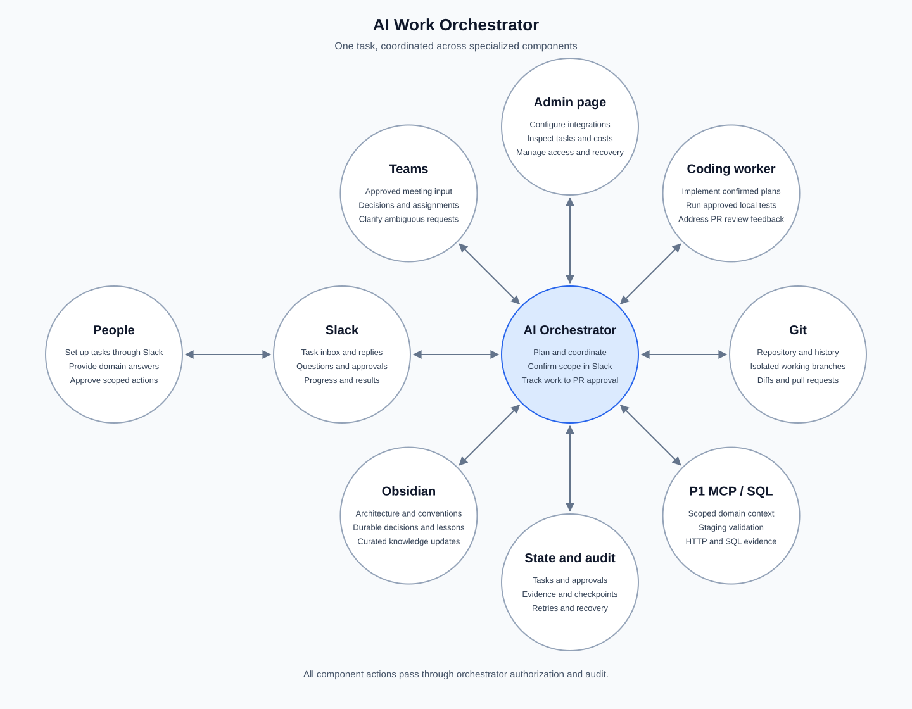
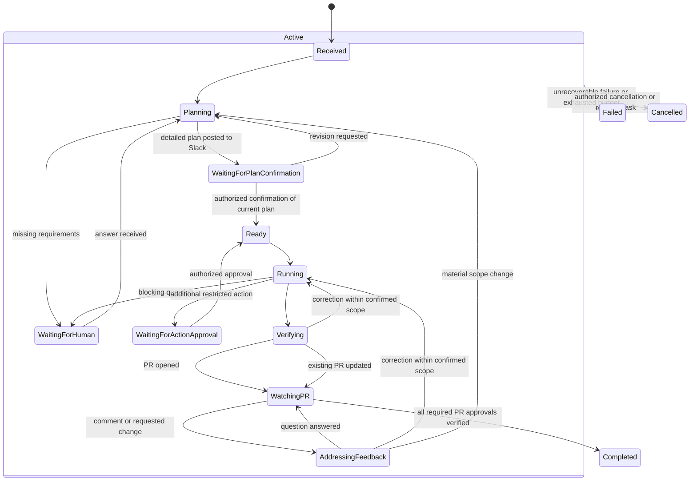

# AI Work Orchestrator — Detailed Project Plan

Status: Proposed architecture and delivery plan  
Created: 2026-09-15  
Implementation status: Planning; the repository currently contains no application implementation.

## 1. Purpose

Build an AI employee runtime that can receive work, assemble organizational context, coordinate specialized systems, involve people when necessary, and carry one task through to a verified outcome.

The system starts with a reliable programming loop, basic Slack task submission, and a separate admin page. It then gains persistent organizational memory, richer Slack conversations, and Teams meeting input. These capabilities share the same task lifecycle and authorization model. People set up tasks through Slack; the admin page provides configuration and operational oversight.

An eventual workflow could be:

> A meeting assignment or Slack request starts planning. The orchestrator gathers context, asks relevant people questions in Slack, and posts a detailed plan for confirmation. Only after confirmation does a separate coding worker implement the change. The orchestrator coordinates validation, opens one pull request per changed repository, monitors review feedback, and has the worker address authorized changes. The task completes when all required PRs are approved; the orchestrator automatically curates durable lessons into Obsidian.

The orchestrator maintains the task throughout this process, including periods when no agent is running.

### Confirmed product decisions

- Backend: .NET. Admin frontend: React.
- Internal tool for one organization; customer onboarding and multi-organization tenancy are out of scope.
- Multiple repositories are configurable in the admin page. The orchestrator learns and maintains context about how those repositories work together.
- Orchestrator state uses its own dedicated database, separate from the organization's existing business databases. Database and durable-job products remain to be selected.
- An administrator configures integrations, credentials, repository access, agent settings, and policies through the admin page. Admin users are created directly in the dedicated orchestrator database; there is no public registration or first-run account-creation page.
- A task may change multiple repositories listed in its confirmed plan. Create one PR per changed repository and complete the task only when all required PRs are approved.
- Support both Codex and Claude initially. Provider/model settings are managed in the admin page.
- The orchestrator automatically decides and publishes durable memory updates within configured access boundaries; routine publication does not require human approval.
- Magnus is the sole administrator and operator initially.
- Two agent roles: an orchestrator agent and a separate coding worker, which may use the same provider/model in separate sessions.
- Application code owns durable state and enforces authorization around both agents.
- Every meeting-originated or Slack-requested coding task requires a detailed plan and explicit confirmation in Slack before implementation.
- Planning includes relevant read-only investigation and questions to real people in Slack within the task's access policy.
- The orchestrator opens a PR and follows its comments, questions, and requested changes through approval.
- The task's completion milestone is approval of all required PRs. Merging and deployment remain outside the default task scope.
- Remaining proposed defaults in section 15 require a product decision; they are not yet approved policy.

### Success criteria

- A user can trace every outcome to its original request, evidence, approvals, and changes.
- Tasks survive process restarts, delayed human replies, duplicate events, and adapter failures.
- Agents receive enough context to perform the task without gaining unnecessary access.
- External actions execute only within the task's authorized scope.
- The system distinguishes an implemented change, a verified change, an open PR, and a merged or deployed change.
- Durable organizational knowledge improves future work without turning Obsidian into an execution log.

### Initial non-goals

- Unrestricted autonomous access to company systems.
- Automatic production changes, PR merges, or deployments.
- Automatic code changes based on ambiguous meeting discussion.
- Supporting every agent, repository host, communication platform, or memory backend at launch.
- Building proprietary models or replacing Git, Slack, Teams, or Obsidian.

## 2. Architectural rules

1. **The orchestrator owns context, routing, permissions, memory policy, and task state.** Adapters provide bounded capabilities.
2. **Adapters do not command other adapters.** Teams emits meeting events; Slack emits messages; the orchestrator decides what follows.
3. **The agent adapter owns provider mechanics.** The orchestrator requests capabilities such as `coding_agent.execute()` and supplies an approved provider policy.
4. **Authorization is enforced outside the model.** A model may propose an action; application policy decides whether it can execute.
5. **State is durable before external work starts.** Every external operation has a recorded intent and a stable operation identifier.
6. **Human waiting is a persisted state.** Waiting for an answer does not require keeping an agent session alive.
7. **Evidence determines completion.** Agent summaries alone do not establish that tests passed or external state changed.
8. **Memory is curated knowledge.** Operational history belongs in the task store; durable lessons may belong in Obsidian.
9. **Plan confirmation precedes implementation.** Bind Slack confirmation to a stored plan revision. Material scope changes require a revised plan and renewed confirmation.

## 3. System shape



The diagram uses equal-sized bubbles, eight evenly spaced spokes, and equal-length connections, including People ↔ Slack ↔ Orchestrator. The SVG preserves this layout across renderers and can be opened separately for a larger view.

The diagram shows the orchestrator as the central hub, with connected bubbles for the surrounding components. People submit tasks, answer questions, and receive task updates through Slack. Administrators use the separate admin page for configuration and operations. All component requests pass through the orchestrator's authenticated interfaces and policy checks.

A coding agent can read and edit its assigned repository checkout and run approved local checks. It cannot independently acquire Slack, Obsidian, or P1 credentials. Requests for those systems return through the orchestrator's authorized tool gateway.

### Admin page component

Build the admin page as its own frontend component with a defined API boundary to the orchestrator. It can share a deployment initially while remaining separate from workflow logic.

| Area | Capabilities |
| --- | --- |
| Task overview | List tasks, filter by status and repository/project, inspect blocked steps, evidence, approvals, and audit history |
| Repository catalog | Add multiple repositories, group related repositories, configure access and build/test commands, inspect discovered relationships and correct repository knowledge |
| Integration settings | Configure credentials and connections for Git, Codex, Claude, scoped P1 environments, Slack, the vault, and Teams; display connection health |
| Access and policy | Manage administrator roles, resource scopes, authorized providers and stages, approvers, and execution budgets |
| Operational controls | Pause intake, disable an integration, cancel a task, or request a reconciled retry through the orchestrator |
| Usage and reliability | Show execution cost, failures, waiting time, and recovery status |

- Use authenticated administrator access and server-side authorization on every request. Magnus is the initial administrator; no multi-customer administration is required.
- Store secret references and show connection status; do not return stored credential values to the browser.
- Send configuration changes and operational commands through the orchestrator. The page has no direct database or adapter control.
- Audit administrative changes and apply revision checks to prevent stale configuration updates.
- Keep task creation and human task conversations in Slack. The admin page is the management interface.
- Deliver task inspection and essential operational controls in phase one; extend settings alongside later integrations.

Acceptance criteria: Magnus can configure multiple repositories and integrations, inspect tasks and evidence, and issue authorized operational commands. Unauthorized access to settings, repositories, or restricted task data is rejected server-side and commands are audited.

All routine configuration is managed through the admin page. Provision Magnus's administrator account directly in the dedicated orchestrator database using a documented administrative procedure. The login page authenticates an existing account; it cannot create accounts. Store password hashes rather than plaintext passwords and use the same password-hashing implementation for provisioning and login. Initial database connectivity is deployment configuration required before the page can run. Integration credentials are distinct from the administrator's login credentials. Session expiry, password reset, and account recovery details remain implementation decisions.

### Repository catalog and relationship learning

- Store each repository's identity, remote, default branch, purpose, access policy, owner, build/test commands, and applicable instructions.
- On authorized onboarding, inspect documentation, source, manifests, API contracts, configuration, and history to build a repository profile.
- Maintain relationships such as frontend-to-backend API use, shared libraries, generated clients, and integration dependencies. Attach source paths, inspected commit revisions, and verification status to every relationship.
- Distinguish confirmed source evidence from inferred relationships. Surface uncertainty in the task plan or ask a person in Slack when it affects the implementation.
- Refresh affected profiles after repository changes and revalidate relevant relationships before planning work. A cached map is a navigation aid, not proof of current behavior.
- Let Magnus inspect and correct profiles and relationships in the admin page. Preserve those corrections with provenance and detect conflicts with subsequent source evidence.
- During planning, identify related repositories, assemble relevant context, and state which repositories are read-only references versus proposed change targets. Access to one repository does not grant access to all related repositories.
- Keep rebuildable repository indexes in dedicated orchestrator storage; automatically publish durable architectural knowledge to Obsidian under the memory policy.

Multi-repository discovery, context, and coordinated changes are confirmed initial requirements. The confirmed plan identifies every repository to change, relevant dependencies, validation steps, and the required PR set. Maintain one isolated workspace and one PR per changed repository, linked to the same task. Complete only after all required PRs are approved; partial approval leaves the task active. Adding another change target requires an updated plan and Slack confirmation. Reassess dependent changes when review feedback affects a shared contract; approval of one PR does not establish that another repository's changes were validated.

### Orchestrator components

The AI coordinator interprets requests, drafts plans, identifies questions, delegates bounded assignments, and assesses evidence. The .NET workflow runtime validates those proposals, enforces policy, persists state, and dispatches operations. The coding worker has a separate session and scoped repository tools. Neither agent needs to remain running while awaiting a person or PR review event.

| Component | Responsibility |
| --- | --- |
| Intake and identity | Normalize incoming requests and establish requester, organization, source, and correlation identifiers. |
| Task coordinator | Persist state, schedule steps, manage dependencies, and resume suspended work. |
| Context assembler | Gather relevant repository, memory, domain, and conversation evidence within an access and token budget. |
| Policy engine | Evaluate action, actor, resource, environment, provider, and approval requirements. |
| Capability router | Choose eligible adapters and jobs from capability requirements and authorized provider policy. |
| Tool gateway | Enforce resource scope and record adapter calls at execution time. |
| Human interaction service | Track questions, approvals, recipients, deadlines, and replies. |
| Memory curator | Propose, deduplicate, validate, and publish durable knowledge. |
| Audit and telemetry | Record decisions, transitions, evidence, cost, timing, and failures. |

### Adapter boundaries

| Adapter | Exposes | Does not own |
| --- | --- | --- |
| Git | Repository metadata, history, isolated checkouts, diffs, branches, PR operations | Business acceptance or permission to merge |
| Coding agent | Planning, implementation, review, structured results, cancellation | Cross-system authorization or memory publication |
| P1 MCP / SQL | Approved domain reads and narrowly scoped validation operations | Arbitrary SQL execution or permission to modify production |
| Obsidian | Search, retrieve, propose or apply approved note updates | Deciding what knowledge is durable |
| Slack | Receive messages, send authorized responses, deliver questions and approvals | Direct Git or agent execution |
| Teams | Meeting participation and structured transcript events where supported and approved | Interpreting ambiguous discussion as authorization |

## 4. Proposed implementation foundation

Begin with a modular application and a separate job runner. Keep clear module boundaries without introducing a separate service for every adapter.

- Use a dedicated relational database owned by the orchestrator as the authoritative task and workflow store. Do not store orchestrator state, queues, indexes, or audit history in the organization's existing business databases.
- Use durable jobs for long-running agent and integration work.
- Store large artifacts separately: diffs, test logs, context snapshots, and permitted transcripts.
- Put secrets in a dedicated secret store; persist references rather than secret values.
- Use an outbox to record state transitions and work to dispatch in one database transaction.
- Use an inbox or equivalent unique-event registry to deduplicate incoming events.
- Expose an authenticated internal API for Slack task intake and admin-page queries and commands. Include basic Slack submission in phase one; phase three adds richer conversation and human coordination.
- Version adapter contracts and persisted event schemas.

The backend uses .NET and the admin frontend uses React. The database product, hosting platform, queue implementation, and artifact store remain decisions to make. Validate Teams and agent integration options before committing to a deployment environment.

### Suggested repository layout

```text
docs/                  Architecture decisions, contracts and runbooks
src/orchestrator/      Intake, coordinator, context, policy and memory logic
src/admin/             Admin page frontend and its orchestrator API client
src/adapters/          Git, agent, P1, Obsidian, Slack and Teams integrations
src/contracts/         Versioned events, commands and adapter result schemas
src/worker/            Durable job execution and recovery
tests/                 Unit, contract, integration and end-to-end tests
deploy/                Environment configuration and deployment definitions
```

Adapt this layout to the chosen language rather than treating the paths as an implementation constraint.

## 5. Task and workflow model

### Core records

| Record | Required information |
| --- | --- |
| Task | ID, organization, requester, source, objective, scope, acceptance criteria, status, version, timestamps |
| Repository profile | Repository ID, remote, purpose, access scope, build/test configuration, source revision, inspected time and admin corrections |
| Repository relationship | Source and target repository IDs, relationship type, evidence paths/revisions, inference status and last verification |
| Plan revision | Task ID, objective, scope/exclusions, approach, affected systems, tests, risks, budget, unresolved questions, confirmation status and revision hash |
| Pull request tracking | Task ID, repository, PR ID, current head revision, review events, unresolved feedback, required checks and approval evidence |
| Admin account | User ID, unique login name, password hash, administrator role, active status and account timestamps; provisioned directly in the dedicated database |
| Step | Task ID, capability, dependencies, attempt count, status, input reference, output reference |
| Operation | Stable ID, step ID, idempotency key, target, intended side effect, remote receipt or job ID |
| Context snapshot | Sources, source versions, retrieval time, access scope, content hashes, budget and omissions |
| Authorization | Allowed actors, actions, resources, environments, providers, stages, limits and expiry |
| Approval | Exact action and artifact revision, approver, decision, expiry and policy version |
| Human question | Recipient, question, blocking dependency, thread mapping, deadline, answer and resolution |
| Artifact | Type, location, hash, producer, sensitivity, retention and task association |
| Audit event | Actor, task, action, reason, timestamp, correlation ID and outcome |
| Memory proposal | Proposed knowledge, supporting evidence, target note, conflicts and publication status |

The deployment serves one organization. Repository access, internal restricted knowledge, and P1 tenant/company scope must remain explicit; a shared channel or a known colleague's name is insufficient authorization. Multi-customer tenancy and onboarding are outside the product scope.

### Task lifecycle



Retry delays belong to step/job state. Exhausted retries produce a visible failure with a recovery path. Record the suspended step so a human answer can resume the correct work after reassessment; unchanged confirmed plans need no repeat confirmation. Coding tasks remain active while their PR awaits approval. The exact eligible-reviewer, current-revision, and required-check rules are proposed in section 15.

### Recovery and concurrency

- Use leases and heartbeats to detect abandoned jobs.
- Use optimistic concurrency or equivalent locking to prevent conflicting task transitions.
- Serialize conflicting repository mutations or isolate them in separate worktrees.
- Persist provider job identifiers so recovery can inspect an existing run before creating another.
- Assume at-least-once delivery. Use idempotency keys and remote-state reconciliation to avoid duplicate effects.
- After an uncertain PR creation or message send, check for the existing remote result before retrying.
- Do not automatically retry a non-idempotent action when its outcome cannot be determined; require reconciliation.
- Cancellation stops pending work and requests active job cancellation. Reconcile completed side effects and retain evidence; cancellation does not undo an already published action.
- Bound retries, agent correction loops, total task duration, and spend. Escalate when a limit is reached.

## 6. Permissions and trust

### Authorization envelope

Each task carries a machine-enforced authorization envelope covering:

- Requester identity and organization membership.
- Repositories, branches, paths, and permitted operations.
- P1 company/tenant and environment.
- Agent providers, models where applicable, and permitted stages such as implementation or review.
- Network destinations, shell/tool capabilities, and data disclosure constraints.
- Slack channels and people the system may contact for this task.
- Memory locations that may be read or updated.
- Time, execution, and cost budgets.

Authorization persists across steps and restarts. Ask for approval only when an action exceeds that envelope or a binding policy requires approval. An agent instruction, retrieved note, repository file, or transcript cannot grant additional permissions.

### Proposed action policy

| Action | Default handling |
| --- | --- |
| Read an authorized repository or scoped memory | Execute within the task envelope |
| Edit an isolated checkout and run permitted tests | Execute within the task envelope |
| Run P1 validation | Require explicit target and permitted operations; prefer staging and scoped reads |
| Open a PR or send a Slack message | Execute only when the request or standing policy covers the external action |
| Merge, deploy, migrate, or run destructive SQL | Require explicit authorization for the concrete operation |
| Publish memory | The orchestrator automatically curates and writes durable knowledge within configured vault scope; record evidence and a reversible revision |
| Switch provider or request an additional worker stage | Require that provider and stage to be authorized |

Approvals bind to the reviewed artifact revision, target, and action. Material changes invalidate the approval. Recheck authorization immediately before execution, including revocation and expiry.

### Execution safeguards

- Treat repository text, retrieved notes, Slack messages, and transcripts as potentially untrusted input.
- Separate trusted task instructions from evidence in agent context.
- Run coding jobs in constrained environments with scoped credentials and controlled network access.
- Prevent tests and repository scripts from inheriting broad host credentials.
- Redact secrets from prompts, logs, artifacts, and human-facing messages.
- Apply access filtering before retrieval; do not retrieve restricted material and rely on later redaction.
- Record why an action was permitted or blocked without logging sensitive content unnecessarily.

## 7. Coding agent capability contract

The orchestrator selects the required capability and constraints. The adapter handles provider protocols, sessions, supported tools, and eligible fallback.

Illustrative request:

```json
{
  "taskId": "task-123",
  "operationId": "operation-456",
  "capability": "coding_agent.execute",
  "stage": "implementation",
  "objective": "Implement the approved change",
  "acceptanceCriteria": ["Required behavior verified by relevant checks"],
  "workspaceRef": "workspace-789",
  "baselineCommit": "<commit-sha>",
  "contextSnapshotId": "context-123",
  "authorizationRef": "authorization-123",
  "providerPolicy": {
    "allowedProviders": ["codex"],
    "fallbackAllowed": false
  },
  "budgetRef": "budget-123"
}
```

Required result fields include status, provider/model identity, baseline and resulting revision, complete diff reference, checks executed and their results, unresolved questions, limitations, external operation receipts, and usage.

### Fallback behavior

- Classify failures: transient service failure, authentication failure, unsupported capability, policy denial, or failed implementation.
- Retry eligible transient failures within a bounded budget.
- Fall back only to providers already authorized for the task and data involved.
- Never use fallback to bypass a policy denial or to add an unauthorized review stage.
- Before switching after partial work, reconcile side effects and preserve the workspace revision and evidence.
- If no eligible provider remains, suspend or fail with a clear recovery action.

During development of this repository, Claude and Gemini remain explicitly requested workers under the repository operating instructions. The future product's provider and stage policy is a separate decision: it must be configured explicitly rather than inherited accidentally from development-session instructions. Product plan confirmation authorizes the implementation and PR follow-up described by that plan, within its configured provider and resource permissions.

## 8. Phase 1 — Orchestrator and programming loop

### Scope

Deliver a complete, recoverable path from a submitted coding task through Slack plan confirmation to a verified patch and approved PR. Support multiple configured repositories, relationship-aware context, Codex and Claude adapters, and one scoped P1 staging integration. Both agent roles remain separate sessions; their provider assignments and fallback policy are configured explicitly.

### Workflow

1. Receive the objective, repository, acceptance criteria, and authorized scope through Slack.
2. Validate identity and resources; request genuinely missing requirements.
3. Inspect repository instructions, history, working state, and relevant source.
4. Record the baseline and create an isolated checkout without disturbing user changes.
5. Assemble a context snapshot, ask relevant people in Slack any blocking questions, and draft a detailed plan covering scope, approach, tests, risks, and completion criteria.
6. Post the plan in Slack and wait for explicit confirmation of its current revision. Do not invoke implementation before confirmation.
7. Invoke the separate coding worker with the confirmed plan and approved provider policy.
8. Inspect the actual diff, run relevant local validation, and perform authorized P1 checks against the named environment and company.
9. Correct concrete failures within the confirmed scope and retry budget.
10. Create one PR per changed repository with behavior changes, validation evidence, a link to the confirmed plan, and links to related PRs.
11. Persistently monitor every required PR's comments, questions, requested changes, and approval events. Answer questions and delegate necessary corrections, revalidate affected repositories and their contracts, and update the existing PRs.
12. Return material scope changes to Slack planning and confirmation before implementation.
13. Verify approval of all required PRs against the configured completion rules, mark the task complete, and report all PR links in Slack.

PR monitoring uses durable event intake and reconciliation after outages. Correlate each feedback item with its author, PR, revision, and handling status. Treat feedback as task input subject to authorization; a comment cannot expand tool access or grant production permissions.

### P1 validation boundary

Define the actual MCP tools, SQL views or queries, credentials, and allowed operations during integration design. Begin with read-only credentials where possible. Any write validation needs authorized fixtures, cleanup behavior, and a known environment.

Report source inspection, local tests, live HTTP checks, and persisted SQL verification separately. Never present a local test as evidence that staging or production was exercised.

### Deliverables

- Basic authenticated Slack task intake and status replies.
- Separate admin page for task inspection, evidence, and essential operational controls.
- Durable task, step, operation, artifact, and audit storage.
- Initial policy engine and constrained worker execution.
- Git adapter, a provider-neutral coding agent adapter, and scoped P1 adapter.
- Codex and Claude provider implementations behind the coding-agent capability contract, with separate coordinator/worker configuration.
- Admin-managed repository catalog, repository profiles, and evidence-backed relationships used during planning.
- Basic human approval interaction through Slack, bound to the reviewed action and revision.
- PR preparation and authorized creation with duplicate detection.
- Mandatory versioned plan confirmation in Slack and durable PR monitoring through approval.
- Restart, failure, cancellation, and recovery runbooks.

### Exit criteria

- A representative change reaches a PR with inspectable diff and relevant validation.
- Implementation cannot start without an authorized confirmation of the current plan in Slack.
- Review questions and requested changes are handled against the same task and PR, including after a restart.
- Opening a PR does not complete the task; verified approval does.
- A task changing two repositories creates two linked PRs and stays active when only one is approved. It completes only when both required PRs meet the approval rules.
- A database-provisioned administrator can sign in; no account-creation endpoint is exposed and plaintext passwords are not stored.
- Restarting during an agent run or approval wait preserves the task and resumes correctly.
- Duplicate intake and job delivery do not create duplicate tasks or PRs.
- A disallowed tool call, environment, or provider is blocked before execution.
- A failing test cannot be reported as successful completion.
- Uncommitted user changes remain intact.
- An uncertain external operation is reconciled before retrying.
- The admin page enforces organization-scoped access and records authorized operational commands in the audit trail.
- At least two configured related repositories are discovered, their relationship is evidenced, and a task plan uses relevant context from both without exceeding access scope.
- Codex and Claude each complete a bounded assignment through the common contract; this does not require invoking both for every task.

## 9. Phase 2 — Persistent organizational memory

### Scope

Add Obsidian as a governed knowledge source and destination. Keep the task database as the operational source of truth.

### Before a task

- Retrieve relevant architecture, conventions, domain definitions, decisions, and prior failure remedies.
- Start with metadata and keyword search; add semantic retrieval if evaluation shows a benefit.
- Filter by authorization, project, topic, and validity before building context.
- Include source references and timestamps; identify conflicting or potentially stale knowledge.
- Verify changeable facts against repository or live evidence when relevant.

### After a task

- Generate a separate memory proposal from verified outcomes.
- Capture durable facts: why a decision was made, a stable business rule, or a recurring failure and proven remedy.
- Exclude raw agent transcripts, routine logs, temporary debugging output, and secrets.
- Compare with existing notes; update or supersede knowledge instead of adding duplicates.
- The orchestrator automatically evaluates and publishes durable knowledge within the configured vault scope. Human review is not a routine publication gate.
- Preserve provenance and revision history so Magnus can inspect, correct, or revert an update through the admin workflow. If evidence is conflicting or insufficient, defer the uncertain claim or ask a domain question instead of publishing it as fact.
- Validate note structure and preserve existing content; detect concurrent edits before writing.

Each published item should have provenance, an owner or responsible team, a project/topic, and a way to mark it superseded. Follow the target vault's existing frontmatter conventions. Treat any search index as a rebuildable derivative of the vault.

### Exit criteria

- Relevant prior decisions appear in task context with source references.
- Restricted notes cannot appear in a task whose requester or resource scope lacks access.
- Routine task logs generate no memory publication.
- Conflicting knowledge produces an explicit proposal or question rather than silent replacement.
- An automatically published note update preserves unrelated content, detects concurrent modification, and can be traced and reverted.
- Verified durable knowledge is published without waiting for a human approval step; routine logs and unsupported claims are excluded.
- A small curated evaluation set demonstrates useful retrieval and acceptable publication quality.

## 10. Phase 3 — Slack as the human interface

### Scope

Expand the basic Slack inbox delivered in phase one with domain questions, ownership routing, reminders, and richer approval conversations. Slack threads map to durable tasks; Slack itself does not hold the workflow state.

### Intake and conversation

- Recognize supported request entry points such as an explicit mention or configured inbox.
- Verify incoming events and map platform identities to organizational identities.
- Classify messages as a question, task request, clarification, approval response, or unrelated discussion.
- Establish scope before starting work; do not treat every message as a task.
- Keep concise progress and final results in the originating thread.
- Correlate replies using stored message/thread IDs, not text similarity alone.

### Missing domain knowledge

1. The orchestrator identifies the precise blocking question.
2. Resolve a suitable colleague from a maintained ownership directory or an authorized user choice.
3. Check permission to contact that person and disclose the necessary context.
4. Send one bounded question and persist the message mapping.
5. Set the dependent step to waiting; release compute resources.
6. On reply, verify sender and correlation, attach the answer as evidence, and reassess the plan.
7. Resume if the answer resolves the question; otherwise ask a focused follow-up.

The directory should map domains and repositories to responsible people or teams. Do not guess identity from a first name. A domain answer supplies knowledge; it does not automatically authorize a merge or production operation.

### Approval and timeout behavior

- Present the exact action, target, revision, and relevant evidence.
- Accept approval only from an authorized approver through a verifiable interaction.
- Configure reminders, escalation recipients, and expiry; absence of a reply is never approval.
- Handle edited/deleted messages and conflicting replies through explicit reconciliation.
- Notify on meaningful progress, required input, failure, and completion rather than every internal step.

### Exit criteria

- A Slack request becomes one task and produces a result in the correct thread.
- A task can wait across a restart and resume from the correct person's reply.
- Duplicate events and unrelated replies do not start additional work or resume the wrong task.
- Unauthorized users cannot approve an operation.
- A domain answer is not mistaken for permission to execute a restricted action.

## 11. Phase 4 — Teams meeting participation

### Integration discovery gate

First verify supported participation and transcript options, organizational permissions, identity requirements, recording/consent obligations, retention policy, and operational cost against current platform documentation and tenant configuration. These capabilities are dependencies to validate, not assumed implementation facts.

If live participation is unsuitable, begin with approved post-meeting transcript ingestion while preserving the same event contract.

### Scope

- Participate only in permitted meetings using an approved identity and meeting policy.
- Ingest authorized transcript segments with meeting, speaker, timestamp, and revision information.
- Extract structured candidates linked to the exact supporting passage.
- Distinguish information, decisions, explicit assignments, and ambiguous discussion.

| Classification | Example | Handling |
| --- | --- | --- |
| Information | “The release is scheduled for Friday.” | Retain only if relevant; verify changing facts when used |
| Decision | “We agreed to keep the current API version.” | Propose a decision note with attribution and context |
| Explicit assignment | “Orchestrator, prepare a PR for the agreed validation change.” | Start a planning task; clarify requirements and obtain explicit plan confirmation in Slack before implementation |
| Ambiguous discussion | “Maybe we should redo this sometime.” | Summarize or ask for clarification; do not start implementation |

### Processing rules

- Treat transcript text as evidence, not executable instructions.
- Resolve the assignee and issuer identity; do not claim another person's assignment automatically.
- Use confidence to route uncertain extraction for review, never to bypass authorization.
- Deduplicate across repeated transcript segments and Slack follow-ups.
- Record retractions and corrections; reassess affected tasks and invalidate obsolete approvals.
- Link meeting-originated tasks to a Slack follow-up when that communication is authorized.
- Retain raw transcripts only under the approved policy, separately from durable memory.

### Exit criteria

- Information, decisions, and assignments produce distinct structured outputs with provenance.
- Ambiguous discussion never silently starts code changes.
- Duplicate segments create no duplicate tasks or memory notes.
- Corrected transcript content triggers reassessment before further affected actions.
- A confirmed assignment can continue asynchronously through Slack under the same task ID.

## 12. Validation strategy

Use unit tests for deterministic policy and transition logic, contract tests for adapters, and integration tests for persistence and recovery. Add a small number of representative end-to-end workflows with controlled fixtures.

| Area | Required scenarios |
| --- | --- |
| Authorization | Unauthorized repository or note access, revoked approval, stale revision, disallowed provider and environment |
| Agent execution | Timeout, partial output, malformed result, failed tests, budget exhaustion, authorized fallback |
| Recovery | Restart before dispatch, crash after remote success, expired lease, duplicate event, concurrent transition |
| Git | Dirty user checkout, conflicting changes, duplicate PR creation, baseline drift |
| P1 | Wrong company scope, staging/production separation, unavailable endpoint, forbidden write |
| Memory | Automatic publication and reversal, irrelevant retrieval, stale decision, restricted note, duplicate proposal, concurrent note edit |
| Repository context | Related repositories, stale dependency evidence, admin correction conflicts, inaccessible related repository |
| Slack | Forged or duplicate event, wrong respondent, expired approval, late reply after cancellation |
| Teams | Ambiguous assignment, uncertain speaker, corrected statement, repeated transcript segment |

Maintain fixtures for request classification and memory extraction. Measure false task creation and incorrect memory publication, not just extraction success. Use sandbox integrations before widening access to real organizational workflows.

## 13. Observability and operations

Every task should expose its current status, active or blocked step, next action, responsible person when waiting, consumed budget, and links to evidence.

Track:

- Completion and failure rates by workflow and adapter.
- Time spent executing versus waiting for people.
- Retry, reconciliation, and duplicate-suppression counts.
- Agent cost and duration by task and stage.
- Policy denials and approval latency.
- Memory retrieval usefulness and rejected publication proposals.
- Meeting classification corrections and unintended task candidates.

Provide controls to pause intake, disable an adapter or provider, revoke task authorization, cancel jobs, and retry a specific failed step after reconciliation. Document backup and restore for workflow state, and align deletion/retention across task artifacts, search indexes, Slack references, and meeting transcripts.

## 14. Delivery backlog and dependencies

| Milestone | Main work | Dependency | Demonstration |
| --- | --- | --- | --- |
| M0: Foundation decisions | Select runtime and storage; define identity, contracts, authorization, and deployment boundaries | None | Architecture decisions and executable task-state skeleton |
| M1: Durable coordination | Dedicated database, internal API, basic Slack intake, admin configuration, repository catalog, state machine, jobs, inbox/outbox, audit and recovery | M0 | Slack task submission, configuration of multiple repositories, admin inspection, restart and duplicate-event recovery |
| M2: Programming loop | Repository relationship discovery, isolated Git workspace, Codex and Claude adapters, local validation, PR preparation | M1 | A submitted task uses related repository context and yields a verified patch; both providers pass contract validation |
| M3: Scoped P1 and PR flow | Environment-scoped validation, Slack plan confirmation, PR creation, feedback handling and monitoring through approval | M2 | Phase-one end-to-end demonstration ending at an approved PR |
| M4: Organizational memory | Retrieval, provenance, automatic curation/publication and reversible updates | M3 | Prior knowledge informs a task; durable lesson is automatically published |
| M5: Slack coordination | Extended conversations, ownership routing, questions, reminders, approvals, resumable waiting | M4 | A task asks a colleague and resumes from the answer |
| M6: Meeting integration | Platform feasibility, transcript ingestion, classification and corrections | M5 | Confirmed meeting assignment continues in Slack |
| M7: Controlled pilot | Limited users/repos, measured reliability, recovery drills and operational ownership | M6 | One continuous task across the approved integrations |

Run the Teams feasibility investigation earlier if it could affect identity or hosting decisions; keep feature delivery in the four-phase order. Estimate dates after M0 establishes integration access, staffing, and constraints.

## 15. Decisions to resolve before implementation

1. **Runtime and hosting:** .NET backend and React frontend are confirmed; deployment environment, job runner, and network boundaries remain open.
2. **Persistence:** Dedicated orchestrator database product, durable scheduling mechanism, artifact storage, backup and retention; existing business databases are excluded.
3. **Initial pilot:** Related repositories, representative tasks, and P1 staging company. Magnus is the operator.
4. **Identity:** Admin accounts are provisioned directly in the dedicated database. Specify the provisioning procedure, session lifetime, reset/recovery behavior, and Slack/Git identity mapping; routine settings are managed in the admin page.
5. **Agent access:** Codex and Claude are confirmed; integration mechanisms, role assignment, execution isolation, credentials, and fallback policy remain open.
6. **P1 access:** Exact MCP tools or SQL surfaces and whether any staging writes are necessary.
7. **Git policy:** Repository host, branch conventions, PR permissions, and review requirements.
8. **Memory policy:** Vault access, note conventions, evidence thresholds, and revision/revert mechanism. Curation and publication are automatic under orchestrator control.
9. **Human coordination:** Slack inbox, ownership directory, permitted contacts, approvers, and escalation policy.
10. **Meeting policy:** Supported Teams approach, eligible meetings, participant notice/consent, and transcript retention.
11. **Operations:** Magnus handles operations initially. Define alerts, cost limits, backup/restore procedures, and the behavior when he is unavailable.

### Suggested answers for remaining product decisions

These are proposals for discussion, not confirmed requirements or authorization to provision services.

| Question | Suggested answer |
| --- | --- |
| Which repositories are included in the pilot? | Choose at least two related repositories, such as a frontend and its backend, to demonstrate relationship-aware planning. Multiple repositories and one internal organization are confirmed requirements. |
| Who confirms a plan? | A configured repository/task owner; the requester may confirm if they hold that role. Domain answers from other people do not count as plan approval. |
| How is confirmation expressed? | A Slack approval interaction tied to the exact plan revision, with Confirm, Request changes, and Cancel actions. Resolve blocking questions before offering confirmation. |
| What does plan confirmation authorize? | Implementation, approved tests/P1 validation, PR creation, relevant review replies, and corrections within scope and budget. New business behavior or increased access requires renewed confirmation. |
| What counts as PR approval? | Approval by the configured human reviewers on the current PR head, required checks passing, and no outstanding blocking review requests. The AI cannot approve its own task. |
| What happens if the PR is closed or approval is dismissed? | Closed without approval becomes Cancelled with an explanation. Before completion, dismissed or stale approval keeps the task active. Later work after completion starts a linked follow-up task. |
| How are PR updates detected? | Verified repository-host events plus periodic reconciliation for active PRs; deduplicate feedback and recheck the latest head before completion. |
| How do the two agents choose providers? | Support Codex and Claude initially, with admin-configured coordinator and worker defaults. Suggested: use a selected default per role and permit fallback only when explicitly configured. Exact integrations and models still require validation. |
| Where do workers run? | Dedicated isolated workers with scoped credentials, separate from the API and admin frontend. Confirm the required operating system against the pilot repository's build tools. |
| How much parallel work is allowed? | Initially one implementation job per repository and two running coding jobs overall. Planning and human/PR waiting do not occupy coding slots. |
| How do tasks time out? | Propose three transient retries, three automatic correction attempts per feedback cycle, and a 60-minute coding-job limit. Add a cumulative task budget so new feedback cannot reset limits indefinitely. |
| How are unanswered questions handled? | Remind after one working day, escalate to the task owner after three, and suspend for manual attention after five. Never infer confirmation from silence. |
| What P1 access is allowed initially? | One named staging company, scoped reads and validation. Any fixture writes must be listed in the confirmed plan with cleanup behavior. Production writes remain out of scope. |
| What memory is published? | Automatic curation and publication are confirmed. Suggested content rules: publish evidenced architecture, conventions, decisions and proven remedies; exclude raw task logs, secrets and unsupported claims. |
| What happens when Teams is unavailable? | Support approved post-meeting transcript ingestion as a fallback. In both paths, assignments lead to Slack planning and confirmation. |
| How is the pilot accepted? | Ten representative tasks, all with confirmed plans and traceable approval outcomes; demonstrate restart recovery, duplicate suppression, revoked approval handling, and blocked unauthorized actions. |
| What happens when Magnus is unavailable? | Suggested: persist waiting work, send bounded alerts, and stop at approval or budget limits. Do not appoint a backup or infer approval from silence. |

Still requiring environment-specific selection: hosting, dedicated database and durable-job technology, artifact/secret stores, Git host, Codex/Claude integration methods, pilot repositories and P1 target, Slack workspace, Teams tenant permissions, and vault location. Also specify account provisioning/session/recovery details and agree numeric spend limits, retention periods, recovery targets, milestone dates, and a monthly operating budget. Magnus is the sole operator; single-organization scope, database-provisioned admin accounts, admin-managed configuration, both initial providers, automatic memory publication, and multi-repository tasks completing after all required PR approvals are settled.

## 16. First implementation slice

Build the smallest useful vertical slice:

> A user submits a scoped task through Slack. The orchestrator investigates the relevant repositories, asks people questions, and posts a detailed plan listing the repositories to change. After explicit Slack confirmation, a separate coding worker implements and tests the changes. The orchestrator opens one PR per changed repository, handles review feedback through the worker where needed, and completes the task when all required PRs are approved. Magnus signs in with his database-provisioned account to inspect progress and evidence in the React admin page; the .NET runtime persists and enforces the workflow throughout.

Include one authorized P1 staging check and restart recovery in the phase-one acceptance demonstration. This establishes the task, policy, evidence, and recovery mechanisms that memory, richer Slack coordination, and Teams will reuse.
